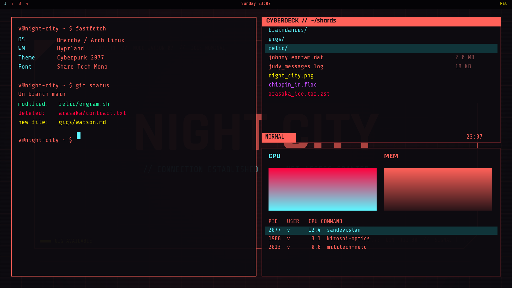

# Cyberpunk 2077 — Omarchy theme

Sit down at a computer in Night City. This theme styles the whole Omarchy
desktop after the in-game interface: the coral-red HUD, the cyan row that
lights up under your cursor, gig-yellow alerts and near-black screens. It
covers the terminal, window frames, bar, launcher, notifications, lock screen,
btop, Neovim and fonts. It also ships a file browser styled like the computers
in Judy's apartment and on desks around the city, and pulls the official CD
Projekt RED wallpapers straight from cyberpunk.net.



## Install

```bash
omarchy theme install https://github.com/martin-irwin/omarchy-cyberpunk-2077-theme.git
~/.config/omarchy/themes/cyberpunk-2077/install.sh
```

The first line clones the theme and applies its colours. The second does what
a theme cannot do by itself:

| Step | What | Skip with |
|------|------|-----------|
| Fonts | Installs Share Tech Mono and Rajdhani (bundled, SIL OFL) into `~/.local/share/fonts` | — |
| Monospace font | `omarchy font set "Share Tech Mono"` (terminal, bar, menus) | `--keep-font` |
| Wallpapers | Downloads 30 official CDPR wallpapers sized for your monitor | `--no-wallpapers` (or `--all-wallpapers` for 50) |
| Cyberdeck | Installs Yazi if missing, binds the Cyberdeck file browser to **Super+Alt+Y** | `--no-cyberdeck` |
| Variants | Builds the Netrunner and Samurai colour variants (see below) | — |
| Screensaver | Only with `--screensaver`: box-art logo screensaver | — |
| Apply | Re-runs `omarchy theme set cyberpunk-2077` | — |

`install.sh --uninstall` removes the fonts, launcher and keybinding and
restores your previous monospace font. Downloaded wallpapers stay in
`~/.config/omarchy/backgrounds/cyberpunk-2077/`.

### Updating

```bash
git -C ~/.config/omarchy/themes/cyberpunk-2077 pull
cyberpunk-variants                 # refresh the Netrunner and Samurai variants
omarchy theme set cyberpunk-2077   # or whichever variant you use
```

## The palette

Built from the game's UI, not its marketing. The box art and logo are
Samurai yellow, but almost every screen you actually look at in the game is
coral on black.

| Role | Hex | In the game |
|------|-----|-------------|
| `foreground` | `#FF6159` | The HUD red: menus, panels, every computer screen |
| `accent` / `cyan` | `#5EF6FF` | Selected/hovered rows, the netrunner highlight |
| `yellow` | `#F3E600` | Gigs, quest markers, warnings |
| `red` | `#FF003C` | Combat, damage, errors (kept apart from the coral) |
| `green` | `#1EF2A0` | Success, git additions |
| `magenta` | `#C34DFF` | Braindance / media |
| `background` | `#0D0B10` | Near-black with a red cast |
| `lighter_background` | `#1C1016` | Dark oxblood panels |
| `selection_background` | `#10353A` | The dark teal wash behind a cyan selection |

### Colour variants

Coral text is what the computers in the game actually look like: Judy's
screens, the laptops on desks and the access points all show coral-red text
on black. That is why the terminal is red. If you'd rather not stare at red
all day, `install.sh` also builds two variants, which appear in Omarchy's theme
picker (*Super+Ctrl+Shift+Space*) as their own themes:

| Theme | Text | Highlight | Look |
|---|---|---|---|
| Cyberpunk 2077 | coral `#FF6159` | cyan | the in-game computers (default) |
| Cyberpunk 2077 Netrunner | cyan `#5EF6FF` | coral | scanner / netrunner interface |
| Cyberpunk 2077 Samurai | yellow `#F3E600` | cyan | the Samurai box-art look |

Variants change only the UI roles (text, highlights, frames, panels). The 16
terminal colours stay the same, so `ls`, git and editors still read correctly.
They share the downloaded wallpapers. The variants are generated copies:
after a `git pull`, run `cyberpunk-variants` to refresh them. The Cyberdeck
and Telegram theme stay coral.

Where the values come from: CDPR has never published a UI palette. The
cyan matches the game's default HUD blue as reported by the HUD Painter
modding community (RGB 93, 246, 255). The coral approximates the game's main
UI red as sampled by players. Treat both as close matches, not official
values.

## Where it applies

Omarchy 4 replaced Waybar, Walker, Mako, SwayOSD and Hyprlock with its own
Quickshell-based shell. This theme styles the shell's equivalent of each
through `shell.<section>.toml` overrides. Those patch just one section each,
so new shell options from future Omarchy updates keep their defaults.

| Old component | Omarchy 4 surface | File |
|---|---|---|
| Waybar | Bar | `shell.bar.toml` |
| Walker | Launcher, menus | `shell.launcher.toml`, `shell.menu.toml` |
| Mako | Notifications | `shell.notifications.toml` |
| SwayOSD | Popups / OSD | `shell.popups.toml` |
| Hyprlock | Lock screen | `shell.lock.toml` |
| — | Polkit prompt, tooltips, controls, wallpaper picker | `shell.polkit.toml`, `shell.tooltip.toml`, `shell.controls.toml`, `shell.image-picker.toml` |
| Hyprland borders | Coral active / oxblood inactive frames | `hyprland_active_border` in `colors.toml` |
| Terminals, Neovim, Helix, gum, VS Code, Obsidian, Chromium | Generated by Omarchy from `colors.toml` | — |
| btop | Hand-tuned "diagnostics readout" (cool cyan → coral → alarm red) | `btop.theme` |
| Icons | `Yaru-red-dark` | `icons.theme` |
| Keyboard RGB | Coral | `keyboard.rgb` |
| Disk-unlock screen | "NIGHT CITY" logo | `unlock.png` |

The theme deliberately ships no `.lua`, terminal configs or `vscode.json`.
Omarchy drops those from any theme installed from a git repo, and leaving
them out makes this machine and a fresh `omarchy theme install` behave the
same. Window corners stay sharp because Omarchy's default rounding is already 0.

## Fonts

The game's UI typeface is **Blender Pro**, a commercial font. The closest
free equivalents:

- **Rajdhani** (Indian Type Foundry, OFL): the condensed, squared-off sans
  of Night City's menus. Used in the wallpaper, unlock logo and preview.
  Installed so you can use it elsewhere.
- **Share Tech Mono** (Carrois, OFL): the monospace for the terminal, bar and
  menus. It has the clipped, technical look of the in-game computers.

Share Tech Mono has a single weight and no Nerd Font icons. Icons fall back to
your installed Nerd Font automatically through fontconfig. If you'd rather
have a full-weight font in the terminal, run
`./install.sh --keep-font` or `omarchy font set "JetBrainsMono Nerd Font"`.
The colours work either way.

## Wallpapers

The official CDPR wallpapers are **not in this repo**. They are CD Projekt
RED's copyrighted artwork. `extras/bin/cyberpunk-wallpapers` (installed as
`cyberpunk-wallpapers`) fetches them from cyberpunk.net's own media API, the
one behind the site's gallery, at the size that fits your largest monitor.
`wallpapers.tsv` lists exactly what it fetches:

- **Characters**: Judy, Johnny, Jackie, Panam, Kerry, Misty, River, Rogue,
  Viktor, Alt, Adam Smasher, V (female and male)
- **Phantom Liberty**: Songbird, Reed, Myers, V & Reed, Dogtown
- **Night City districts**: Night City, Downtown, Corporate Plaza, Japantown,
  Kabuki, North Oak, Heywood, Santo Domingo, Pacifica, Arasaka Waterfront,
  Northside, Badlands
- `--all` adds: the 5th Anniversary and City of Legends posters, Samurai
  jacket, the nine gang wallpapers, and Edgerunners 1 and 2

```bash
cyberpunk-wallpapers                 # core set for your screen
cyberpunk-wallpapers --all           # everything
cyberpunk-wallpapers --res 3840x2160 # force 4K
cyberpunk-wallpapers --list          # dry run
cyberpunk-wallpapers --only 43-ultimate-edition --dest ~/Pictures   # just one
```

Cycle with `omarchy theme bg next`. The repo ships two original wallpapers,
so the theme looks right before the download:

- `01-cyberpunk-2077.jpg`: CYBERPUNK 2077 in box-art yellow with the cyan
  glitch shadow. The real logo is CDPR's custom lettering, which isn't
  available as a font and is trademarked, so this is set in **Chakra Petch
  Bold Italic** (Cadson Demak, SIL OFL), the closest free face: heavy,
  slanted, with clipped corners.
- `00-netwatch.jpg`: a "NIGHT CITY" net-access screen.

## Screensaver

`cyberpunk-screensaver` turns Omarchy's screensaver into the box-art logo:
the brush-script "Cyberpunk" with the spaced 2 ── 0 ── 7 ── 7 beneath,
drawn in Braille characters so the slashes keep their shape. It fits a
1080p screen even at 1.6x scaling.

The logo is CD Projekt RED's trademark, so it isn't in this repo. The script
fetches the official Ultimate Edition wallpaper from cyberpunk.net (black
logo on flat yellow) and traces it on your machine. The screensaver text is
global rather than per-theme, so it's opt-in:

```bash
./install.sh --screensaver     # or run cyberpunk-screensaver any time
cyberpunk-screensaver --restore   # put back the screensaver it replaced
```

## Cyberdeck: the Night City file browser

**Super+Alt+Y** opens Yazi in a floating terminal, skinned like the computers
in the game. The file list is coral, folders are cyan, and the row under the
cursor is cyan on dark teal. It has a `CYBERDECK` header badge, `NET//USER`
and a clock in angular status segments, and prompts like `JACK IN // PATH:`.
Archives read as alarm-red "shards", images gig-yellow, media violet.

**Backspace** or `-` also go up a folder, as well as Yazi's usual `h` / ←.

It runs with its own config (`YAZI_CONFIG_HOME=extras/yazi`), so your normal
`~/.config/yazi` is untouched. You can also run `cyberdeck [dir]` from a
terminal. To use the flavor in your everyday Yazi, copy
`extras/yazi/flavors/night-city.yazi` into `~/.config/yazi/flavors/` and set
`[flavor] dark = "night-city"` in your `theme.toml`.

## Telegram: V's phone

`extras/telegram/night-city.tdesktop-theme` styles Telegram Desktop like the
phone messages in the game. Incoming messages are coral on dark oxblood with a
coral underline, your own are cyan on dark teal, and service notices are
gig-yellow, all on a faint grid background. Open the file from Telegram
(*Settings → Chat Settings → Choose from file*) or just open it in your file
manager. It is generated by `build-theme.py` from Telegram's own night theme,
so every colour key is covered.

## WhatsApp: the same phone, in Ferdium

WhatsApp has no native Linux client, so the skin targets
[Ferdium](https://ferdium.org), a free, open-source app (Apache-2.0) that
puts WhatsApp, Telegram, Signal and others in one window, Trillian-style.
`extras/whatsapp/night-city.css` turns WhatsApp Web into V's phone: coral
text on near-black, incoming messages on dark oxblood, yours in cyan on dark
teal, square bubbles, cyan where WhatsApp is green, gig-yellow links,
Rajdhani as the font.

1. Install Ferdium (`yay -S ferdium-bin`, or the tarball from
   [its releases](https://github.com/ferdium/ferdium-app/releases)).
2. Start it, choose *Use Ferdium without an Account* and add WhatsApp.
3. Run `cyberpunk-ferdium` (with Ferdium closed, so it can also set the app
   to dark mode with the coral accent). `install.sh` does this for you if
   Ferdium is already set up.

**Why it should last:** WhatsApp's class names are generated and change
every few weeks, so the skin doesn't rely on them. Instead it overrides the
colour variables WhatsApp's own design system uses. `build-skin.py`
generates it from `whatsapp-dark-vars.txt`, a dump of all ~1,100 of those
variables taken from the live app. Each one is remapped by role, the same way
as the Telegram theme. After a big WhatsApp redesign, re-dump the variables
(instructions are at the top of `build-skin.py`) and rebuild.

**Not covered:** the QR login screen hard-codes its own light colours, so it
stays cream; you only see it once. If a Ferdium update resets the WhatsApp
recipe, re-run `cyberpunk-ferdium`. The skin also works in a browser with a
user-CSS extension such as Stylus on `web.whatsapp.com`.

## Decisions made while building this

- **Coral, not yellow, is the lead colour.** Most community Cyberpunk themes
  use the marketing yellow `#FCEE0A`. The in-game UI is coral and cyan, which
  is what "sitting at a computer in Night City" looks like.
- **Window frames are flat coral, not a gradient.** The game's panels are
  flat, thin-framed boxes. Focus is shown coral vs dim oxblood.
- **Wallpapers download instead of shipping**, so the repo can be public and
  installable with the standard command.
- **Section overrides instead of a full `shell.toml`**, for forward
  compatibility with Omarchy updates.
- **No Neovim colourscheme plugin.** Omarchy's generated Aether colourscheme
  follows `colors.toml`, and a theme repo can't ship `neovim.lua` anyway.

## Credits and references

- Community themes I looked at first: hongyangchun/omarchy-cyberpunk-2077-theme,
  Doghouse-Mike/omarchy-daemon-mkii-theme,
  marty-schneider/omarchy-night-city (a CyberArch Quickshell HUD, worth
  pairing with this theme), linuxg33k76's Cyberpunk mega themes and
  OldJobobo/omarchy-city-783-theme.
- Fonts: Rajdhani © Indian Type Foundry, Share Tech Mono © Carrois Type
  Design, Chakra Petch © Cadson Demak (used for the wallpaper lettering only, not bundled). All SIL Open Font License 1.1; licence texts for the bundled fonts are in `fonts/`.
- Cyberpunk 2077, its characters and wallpapers are © CD Projekt RED. This is
  an unofficial fan theme and is not affiliated with or endorsed by CD
  Projekt.

Theme code and colour values: MIT (see `LICENSE`).
